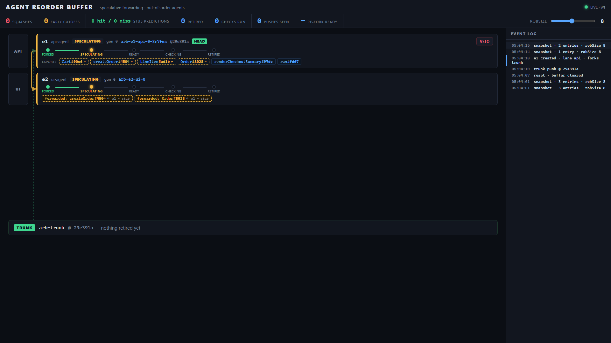
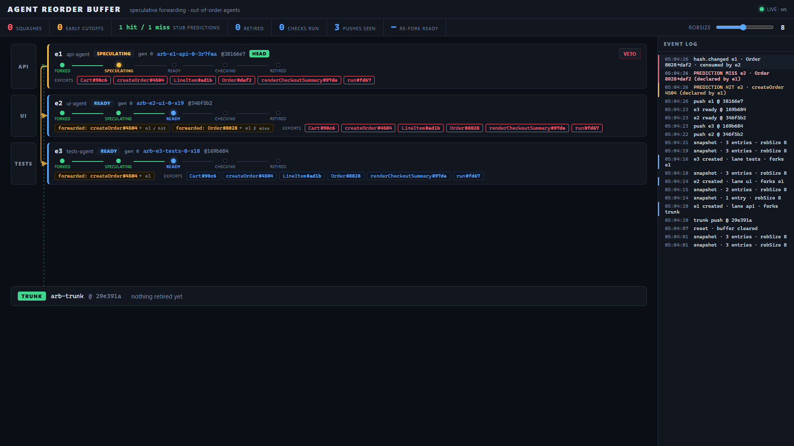
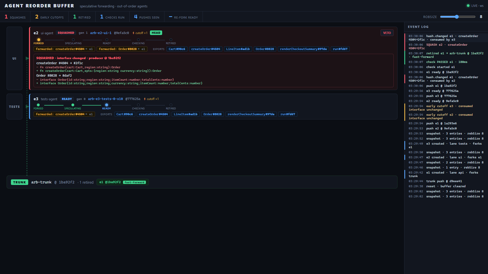
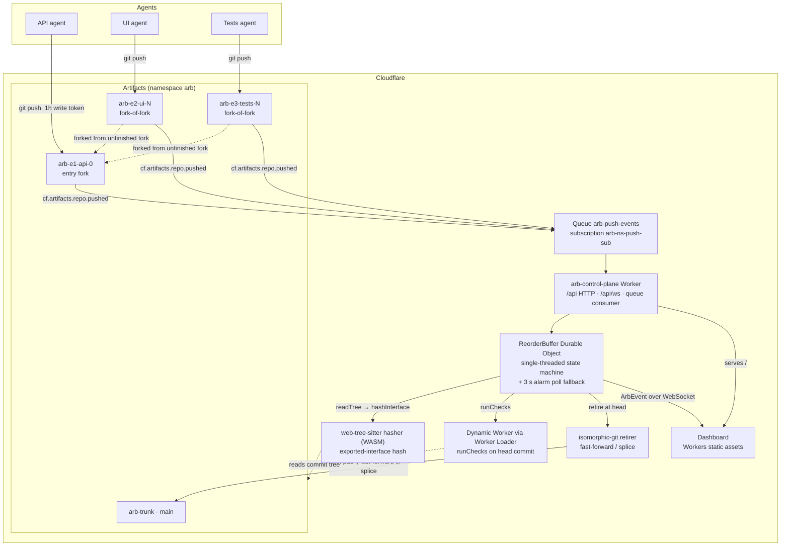

# Agent Reorder Buffer (ARB)

Out-of-order CPU execution applied to coding agents. Every agent change is a
**buffer entry** backed by its own fork on Cloudflare Artifacts. A consumer
change (UI, tests) does not wait for its producer (API) to land: it forks the
producer's *unfinished* fork and starts immediately against the producer's
current interface — Tomasulo-style forwarding. When the producer pushes, a
Durable Object recomputes the producer's exported-interface hash per symbol
and **squashes** only the consumers whose forwarded hash changed; they re-fork
the new head and redo their work with an old-vs-new-signature diagnosis.
Entries **retire** onto trunk in dependency order, as fast-forwards or
path-disjoint splices — never as a textual merge.

**This project was built using Cloudflare Workers and Artifacts.**

## The problem

"UI waits for the API PR" is the main serialization point between parallel
agents. Today's fixes — merge queues, stacked PRs, human review — all work at
merge time: they serialize finished work, and a textual merge conflict is a
lower bound on real incompatibility (interface changes can break a consumer
whose text merges cleanly). Neither queueing nor text merging scales to a
fleet of agents. The ARB moves integration to *dispatch* time: dependents
start immediately on speculatively forwarded interfaces and are corrected only
when reality differs from what they were forwarded.

## The mechanism, as a CPU reorder buffer

| CPU | ARB |
|---|---|
| Reorder buffer entry | `Entry` {fork, exported interface hashes, consumed hashes, producer} |
| Operand forwarding | A consumer forks the producer's unfinished fork |
| Value prediction | `stub` sources declare intended signatures at entry creation; consumers forward against the predicted hashes until the producer's first push confirms (hit) or squashes (miss) |
| Broadcast on the common data bus | `cf.artifacts.repo.pushed` events via a Queue |
| Squash on mispredict | Consumed interface hash changed → re-fork + diagnosis |
| Retirement | In-order fast-forward / splice onto `arb-trunk` main |
| ROB size | `robSize` config — the speculation-depth cap the human sets |

Concretely, per `app/CONTRACTS.md`:

- **Forwarding.** `POST /api/entries` with `producerId` forks the producer's
  fork at its current head (`fork-of-fork` — verified working in spike 3) and
  records `entry.consumes`, the producer symbols the new entry depends on,
  with the hashes it forked against.
- **Value prediction (declared stubs).** `POST /api/entries` may carry `stub`:
  TypeScript sources declaring the entry's *intended* exported signatures. The
  control plane hashes them with the real hasher, so `entry.exports` starts as
  predicted hashes and `entry.predicted` lists the unconfirmed symbols.
  Consumers registering while `predicted` is non-empty forward against the
  declared hashes (pinned in `consumes`). The producer's first real push
  resolves each pinned symbol per consumer: match → `prediction.hit`; diverge →
  `prediction.miss` and a squash with reason `prediction-miss`, whose diagnosis
  carries the predicted vs actual signature. Verdicts are counted per
  (consumer, symbol) in `stats.predictionHits` / `stats.predictionMisses`.
- **Squash.** Every push recomputes the producer's per-symbol interface hash
  (web-tree-sitter inside the Worker). If a consumed symbol's hash changed,
  each dependent is squashed: re-forked from the producer's new head, its
  agent gets a `Diagnosis` (old vs new signature per changed symbol), and its
  `generation` increments. A squash cascades transitively.
- **Early cutoff.** A push that changes no consumed symbol's hash — e.g. a
  body-only refactor — triggers nothing. Counted in `stats.earlyCutoffs`.
- **In-order retirement.** An entry retires onto trunk only when it is at the
  head of the buffer (lowest `seq`), its producer has retired, its agent has
  marked it ready, and its checks pass on its head commit — run inside a
  Dynamic Worker.
- **Retirement modes.** If the trunk head is an ancestor of the entry head:
  fast-forward via isomorphic-git inside the Worker. Otherwise a
  **path-disjoint splice**: if the paths the entry changed (P) and the paths
  trunk changed since the entry's base (Q) are disjoint, a new commit —
  `arb: splice <entry-head> onto <trunk-head>` — overlays P onto the trunk
  tree with `parents = [trunk head]`, is pushed to the `arb-candidate` ref
  on the trunk repo, re-checked there, and only then `main` is moved to it
  (disjoint changes commute). If P ∩ Q ≠ ∅ the entry is squashed with reason
  `trunk-overlap` and re-forks *from trunk*. There is never a textual merge —
  see the Decision section of `odd/tasks/agent-reorder-buffer.md`; implemented
  in `app/control-plane/src/retire.ts` + `src/splice.ts`.
- **Interface hashes only decide *when to squash early*.** Behavior is still
  verified at retirement: an unchanged signature does not prove unchanged
  behavior.

## What the human decides

Two things, and nothing else:

- **Buffer size** (`robSize`, default 8): the speculation-depth cap.
  `POST /api/config {robSize}`; new entries are rejected with 409 when
  non-retired entries reach the cap.
- **Veto**: `POST /api/entries/:id/veto` on the head entry only. A veto
  squashes exactly that entry's transitive dependents — highlighted on the
  dashboard first — which re-fork from the vetoed entry's own base so they
  can still retire later.

## "Isn't this just stacked PRs?"

No — and the difference is now measured, not rhetorical. Stacks are linear
chains over *finished* work, re-stacked by a human after the producer's PR
lands; a clean rebase can still hide a broken interface. The buffer is a DAG
over *in-progress* work: dependents forward against live forks and are
corrected by interface-hash squashes, never by text merges (`research/top10.md`
Idea 3). Value prediction goes further than any merge-time tool can:
dependents started against an interface the producer had only *declared*,
before it wrote a line. And the verdict is a counter, not a claim — in the live
run the stats read `predictionHits: 2, predictionMisses: 1` (per
consumer-symbol verdicts): both consumers' pinned `createOrder` landed exactly
as declared, while `Order` diverged and its consumer was squashed with a
predicted-vs-actual diagnosis. The machinery caught reality differing
from the declaration automatically (`app/control-plane/NOTES.md`, "Value
prediction (T11)").

| `≈` predicted exports before the first push | hit/miss verdicts land on the first push | ordinary squash with diagnosis |
|---|---|---|
|  |  |  |

## Why it scales — and what the benchmark measured

In a synthetic, in-process benchmark of the pure state machine (no network, no
Durable Object I/O), an interface-changing push squashed exactly the transitive
dependents whose consumed hashes had changed (3,803 pushes checked, 0
mismatches, none outside the dependency subtree), with 3 to 39 squashes per
push in 40-entry components. Today's single-buffer implementation does not yet
scale with the touched edges: its median per-event time rose from 30 µs at
1,000 entries to 394 µs at 10,000 and 16 ms at 100,000, because several steps
scan the whole entry list on every event. Splitting disconnected components
into separate buffers held the work per event flat (about 80 to 190
entry-predicate evaluations at every N, median 3 to 17 µs), which supports the
sharding claim for the state machine itself; cross-component dependencies,
routing, and real Durable Object latency were not measured.
— `app/control-plane/bench/RESULTS.md` (reproduce in ~2 min:
`cd app/control-plane && node --experimental-strip-types bench/run.ts`)

| entries in the buffer | one buffer for all N, median / p95 per event | one buffer per 40-entry component |
|---|---|---|
| 1,000 | 29.6 µs / 92.3 µs | 2.9 µs / 11.9 µs |
| 10,000 | 393.6 µs / 1,462.6 µs | 6.2 µs / 21.0 µs |
| 100,000 | 16.2 ms / 55.2 ms | 17.2 µs / 48.3 µs |

**Honest status.** The deployed control plane still runs **one** `ReorderBuffer`
Durable Object for the whole buffer today, so the left column is the current
cost — paid by every event, including ones that touch two entries, through
full-array scans in `head()`, `squashTree` and the id/repo lookups. The next
step is what the right column approximates: per-connected-component sharding
plus index maps (`Map<id,Entry>`, `Map<repo,Entry>`, a monotone head cursor,
per-entry persistence) inside `rob.ts` — dispatched as T14, not yet
implemented (`bench/RESULTS.md` "Recommended fix"; `app/control-plane/NOTES.md`
reports no such change as of this writing).

- Squash fan-out is bounded by the dependency subtree, independent of N —
  measured: 3 / 12 / 39 squashes for depth-2 / depth-1 / root producers,
  never above 39 across the whole run (`bench/RESULTS.md`).
- Long chains amplify mispredicts; `robSize` bounds that exactly as in
  hardware. Forks are near-free: 10 parallel forks measured at 1.9 s wall
  (`spikes/SPIKES.md`).

## Architecture



Primitive → role mapping:

| Cloudflare primitive | Role in the machine |
|---|---|
| Artifacts fork | One buffer entry = one repo; the speculative register |
| Artifacts fork-of-fork | Forwarding: consumers fork the producer's unfinished fork |
| Artifacts write tokens | Per-entry git credentials (1 h TTL), minted on create/refork |
| Artifacts `repo.pushed` events | The common data bus broadcast |
| Queues (`arb-push-events`) | Push-event fan-in to the control plane |
| Durable Object (`ReorderBuffer`) | The reorder buffer: single-threaded, in-order retirement |
| Dynamic Workers (Worker Loader) | Sandboxed checks on each entry's head commit |
| Workers static assets | Dashboard served at `/` by `arb-control-plane` |
| isomorphic-git in a Worker | Fast-forward / splice retirement onto `arb-trunk` |

Deeper design: [`docs/architecture.md`](docs/architecture.md).

## Repository layout

```
app/
  CONTRACTS.md        shared contracts — the single source of truth
  control-plane/      Worker + ReorderBuffer DO + queue consumer + API
  hasher/             exported-interface hashing (web-tree-sitter WASM)
  checker/            runChecks(): tests inside a Dynamic Worker
  demo/               fixture app, scripted agents, scenario runner, local mock
  dashboard/          static pipeline UI (no build step)
  retirer-spike/      fast-forward retirement proof + reusable module
docs/                 architecture.md, demo-script.md
research/             idea council: dossiers, scored idea pool, top10.md
spikes/               8 platform feasibility spikes with measured numbers
odd/                  task tracking (odd/tasks/agent-reorder-buffer.md)
```

## Run it

Prerequisites: **Node 22** (built and tested on v22.15.1), **Wrangler
>= 4.149.0** (installed per package; older versions cannot create
namespace-scoped event subscriptions — spike 2a), and a **Cloudflare account
with Artifacts** that Wrangler is authenticated to.

### 1. Deploy the control plane

```sh
cd app/control-plane
npm install
scripts/setup.sh        # creates queue + push subscription + wrangler deploy
```

`setup.sh` runs the one subscription the system needs — a namespace-wide push
subscription covering `arb-trunk` and every `arb-e*` fork (per-fork
subscriptions would need runtime REST calls; see `app/control-plane/NOTES.md`):

```sh
npx wrangler queues subscription create arb-push-events \
  --source artifacts \
  --events repo.pushed \
  --source-namespace arb \
  --name arb-ns-push-sub
```

The dashboard is served by the same Worker at `/` (Workers static assets);
`/api/ws` is the live event stream. Optional proof deployments exist for the
library packages — `app/hasher` (`npm run deploy:test-worker`),
`app/checker` and `app/retirer-spike` (`npx wrangler deploy`) — but none are
required; hasher and checker are imported in-process by the control plane.

### 2. Run the demo

```sh
cd app/demo
npm install
npm run demo -- --base https://arb-control-plane.<your-subdomain>.workers.dev
```

Three scripted agents (API/UI/Tests) run the organizers' scenario: the API
agent registers with a declared stub, its first push resolves the predictions
per consumer (hit → keep working; miss → `prediction-miss` squash), a body-only
API refactor is an early cutoff, then a breaking `createOrder` signature change
(two squashes, re-forks, diagnoses), then in-order retirement e1 → e2 → e3.
Fully offline alternative — a local mock control plane with no Cloudflare at
all:

```sh
npm run mock -- --port 8899 --root tmp-mock/live   # terminal 1
npm run demo -- --base http://127.0.0.1:8899        # terminal 2
```

Tests per package: `npm test` (control-plane 33 cases — state machine +
splice + git-level retire + declared-stub prediction; demo scenario cases
incl. a full-run prediction case asserting 2 hits / 1 miss, dashboard 27
event-folding cases, hasher 24 hash checks, checker and retirer-spike unit
suites).

## What is real vs mocked

**Real:** every Cloudflare primitive above — Artifacts repos, fork-of-fork
forwarding, write tokens, `repo.pushed` events through the queue, the DO
state machine, WebSocket events to the dashboard, interface hashing in a
Worker, declared-stub value prediction (live verdicts: 2 hits / 1 miss),
checks in a Dynamic Worker, and fast-forward/splice retirement.
All ports in the deployed control plane are real (no stubs) — the full
scenario ran end to end against `arb-control-plane`; see "Live E2E results"
in `app/control-plane/NOTES.md`.

**Mocked:** agent intelligence. The three agents are deterministic scripts
(`app/demo/src/agents/`): there is no LLM anywhere. Adapting to a squash is a
regex sniff of the producer's signature choosing between two pre-written file
variants; the "fix" for a failing check is likewise pre-written. `app/demo`'s
`mock-server.ts` is a local stand-in for the whole control plane (bare git
repos, poll-based push detection, regex hashing, `-X theirs` merge) and exists
only to make agent state machines testable offline — it is not used against
the real deployment.

## Measured numbers

Every figure was measured in a real run; source file per row.

| What | Number | Source |
|---|---|---|
| Artifacts create→push→read round trip | median 4.28 s (3.35–5.98, n=6) | `spikes/SPIKES.md` |
| `repo.pushed` event latency | median 3.77 s, max 5.88 s (n=10) | `spikes/SPIKES.md` |
| DO alarm poll detection (fallback path) | median 0.70 s, max 1.52 s (n=10) | `spikes/SPIKES.md` |
| Fork / fork-of-fork | 1.9–2.4 s; 10 parallel forks: 1.9 s wall | `spikes/SPIKES.md` |
| Interface hash inside a Worker | ~30 ms CPU median; 2669 KiB upload / 333 KiB gzip | `app/hasher/NOTES.md` |
| Dynamic-Worker check | 4/4 pass in 261 ms; worst cold-machine miss ~7.7 s | `app/checker/NOTES.md` |
| Fast-forward retirement from a Worker | ~0.9 s median; 17–45 ms CPU | `app/retirer-spike/NOTES.md` |
| Sandbox `npm test` on a fork (rejected path) | warm 18.8–20.7 s | `spikes/SPIKES.md` |
| Push → squash, live | ~1.7 s end-to-end (push detection + hash + squash in one poll tick); earlier manual smoke ~8 s | `app/control-plane/NOTES.md` |
| Squash → re-fork done, live | ~2.3 s / ~4.5 s (two parallel forks) | `app/control-plane/NOTES.md` |
| Check in a Dynamic Worker, live | 90–187 ms per commit (incl. 90 ms splice candidate) | `app/control-plane/NOTES.md` |
| Failed check → fix push detected, live | ~2.8 s | `app/control-plane/NOTES.md` |
| Retirement, live | fast-forward 507 ms / 518 ms; splice 1085 ms | `app/control-plane/NOTES.md` |
| Live end-to-end, main scenario | ~38 s wall — 2 squashes, 2 early cutoffs, 3 retired, 3 checks run, 5 pushes seen | `app/control-plane/NOTES.md` |
| Live end-to-end, failing-check scenario | 43.8 s wall — 2 squashes, 2 early cutoffs, 3 retired (e3 via splice), 5 checks run, 7 pushes seen | `app/control-plane/NOTES.md` |
| Live end-to-end with declared stubs (T11) | ~52 s wall — predictionHits 2 / misses 1, 3 squashes, 3 retired, 4 checks run, 7 pushes seen | `app/control-plane/NOTES.md` |
| Live failing-check with declared stubs (T11) | ~50 s wall — same 2/1 verdicts; failing check still blocked retirement (5 checks run) | `app/control-plane/NOTES.md` |
| Reorder-buffer scale bench (state machine) | median per event 30 µs → 394 µs → 16 ms at N = 1k / 10k / 100k single buffer; flat 3–17 µs with per-component buffers; 3,803 pushes, 0 squash-oracle mismatches | `app/control-plane/bench/RESULTS.md` |
| Full 3-agent scenario, local mock | 2 squashes, 4 early cutoffs, 3 retired in ~23 s | `app/demo/NOTES.md` |

## Limitations and next steps

- **Interface hashing is heuristic.** No type checker: unannotated code gets
  literal-based inference, so a body-only change can occasionally move a hash
  (`app/hasher/NOTES.md`). Checks at retirement remain the behavioral gate.
- **Squash window.** Work pushed to a stale fork while its re-fork is in
  flight must be redone (`app/control-plane/NOTES.md` known gaps).
- **Vetoed entries hold buffer slots** until `POST /api/reset` (contract
  semantics: `robSize` counts non-retired entries).
- **Scale-out is now partially measured — and still unfinished.** The
  in-process benchmark shows the single buffer's per-event cost growing with N
  (16 ms median at 100k) while per-component buffers stay flat — but the
  deployed plane still runs one DO, and cross-component routing, real DO
  latency and DO storage limits (~740 B/entry; 74 MB serialized at 100k) are
  unmeasured (`app/control-plane/bench/RESULTS.md`). Index maps + per-component
  sharding (T14) is the tracked next step.
- **Next steps:** index maps and a head cursor in `rob.ts`, then one
  `ReorderBuffer` DO per connected component (T14); Grace Period hand-off
  for breaking changes with readers outside the buffer; LLM-driven agents;
  per-fork event subscriptions; veto confirmation in the UI. (Declared-stub
  value prediction — the T11 item — shipped: `predictionHits` /
  `predictionMisses` are live counters.)
- Prior art and the "why not just stacked PRs" answer: `research/top10.md`
  Idea 3 — stacks are linear chains restacked by humans after the producer
  pushes; the buffer is a DAG over in-progress work with automatic
  interface-hash squash (see the dedicated section above).

## License

MIT — see [LICENSE](LICENSE).
