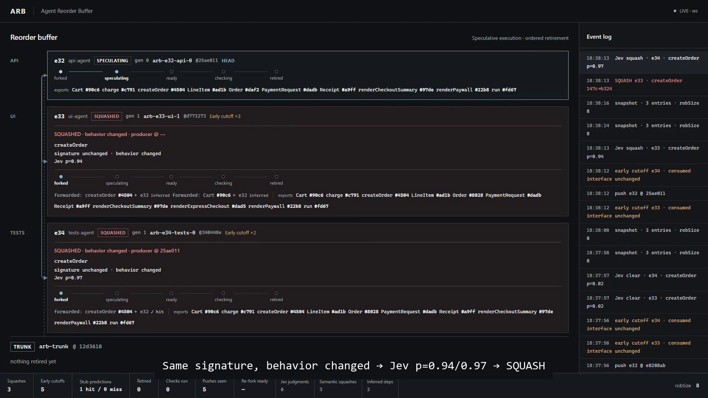
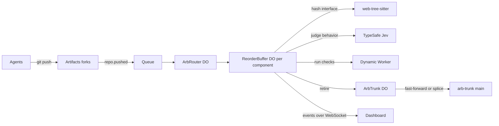

# Agent Reorder Buffer (ARB)

When several coding agents work on one codebase, the UI agent waits for the API agent's pull request
to land, and the text merge at the end can still hide a broken interface. I built the Agent Reorder
Buffer to borrow the fix CPUs found for the same problem decades ago: out-of-order execution with a
reorder buffer. Every agent change is a buffer entry on its own Cloudflare Artifacts fork. A
consumer forks its producer's unfinished fork and starts at once, gets squashed and re-forked only
when the interface it relied on actually changes, and lands on trunk in dependency order with no
textual merge. The live dashboard shows all of it as it happens: agents register, get squashed with
a signature diagnosis, and retire onto trunk.

**This project was built using Cloudflare Workers and Artifacts.**

## What you'll see

The control plane and its read-only dashboard run at
<https://arb-control-plane.lautitomasalejo.workers.dev>. There is also a
walkthrough video: [demo video](VIDEO_URL_TBD).

In the main scenario three scripted agents (API, UI, Tests) share one feature. The API agent
registers with a declared stub of the signatures it intends to write. The UI agent registers without
saying what it depends on, and the control plane infers that from its imports. The Tests agent pins
the stub's `createOrder` signature, which the producer's first push confirms. A body-only refactor
then changes nothing for the consumers. A same-signature change that adds VAT to order totals keeps
the types intact, yet TypeSafe's Jev model judges that the behavior moved and both consumers are
squashed as `behavior-changed`. A breaking `createOrder` signature change squashes them again as
`interface-changed`, and the three entries retire in order.



## The problem

"UI waits for the API PR" is the main serialization point between parallel agents. Merge queues,
stacked PRs and human review all act at merge time, so they serialize finished work, and a textual
conflict is only a lower bound on real incompatibility: an interface change can break a consumer
whose text merges cleanly. Even the textual part is common. In [arXiv
2607.04697](https://arxiv.org/html/2607.04697v2), 48 of 115 pull-request pairs from different coding
agents conflicted textually (41.7%, 95% CI 33-51%), although cross-agent pairs were a small share of
that dataset, so it is not a fleet-wide rate (`research/top10.md`).

The buffer moves integration to dispatch time. Dependents start right away against forwarded
interfaces and get corrected only when what lands differs from what they were given. A stack of PRs
is a linear chain over finished work, restacked by a human after the producer lands; the buffer is a
DAG over work in progress, corrected by interface-hash squashes instead of text merges
(`research/top10.md`, Idea 3).

## How it works

The analogy maps closely. A reorder-buffer entry is an `Entry` holding a fork, its exported
interface hashes, the hashes it consumed, and its producer. Operand forwarding is a consumer forking
the producer's unfinished fork, and value prediction is a declared stub. The common data bus is the
`cf.artifacts.repo.pushed` event stream arriving through a Queue. A mispredict is a squash and
re-fork with a diagnosis, retirement is an in-order fast-forward or splice onto `arb-trunk`, and the
ROB size is `robSize`, the speculation cap a human sets. Contracts:
[`app/CONTRACTS.md`](app/CONTRACTS.md).

**Forwarding and prediction.** `POST /api/entries` with a `producerId` forks the producer's fork at
its current head (fork-of-fork on Artifacts is verified in `spikes/SPIKES.md`) and records the
producer symbols the entry consumes, with the hashes it forked against. An entry may carry `stub`,
TypeScript sources declaring its intended exports, hashed with the real hasher so consumers can
forward against code that does not exist yet. The producer's first push resolves each pinned symbol
per consumer as `prediction.hit`, or as `prediction.miss` plus a squash whose diagnosis shows
predicted against actual. A consumer can also skip declaring what it consumes: on every push the
plane reads its imports, limited to files the entry changed since its `baseCommit`, and emits
`deps.inferred`.

**Squash.** Every push recomputes the producer's per-symbol interface hash with web-tree-sitter
inside the Worker. If a consumed hash changed, each dependent is re-forked from the producer's new
head, its agent gets an old-vs-new signature diagnosis, and the squash cascades transitively. A push
that keeps every consumed hash, such as a body-only refactor, is an early cutoff. On an early cutoff
the plane asks Jev whether the change alters behavior the consumer relies on: a probability of 0.7
or more squashes as `behavior-changed`, 0.4 to 0.7 warns, and below 0.4 is clear. With no key, a
timeout or an HTTP error, the judgment reports `jev.unavailable`, counts as clear, and the buffer
runs on interface hashing alone.

**Retirement.** An entry retires only when it is the oldest in the buffer, its producer has retired,
its agent marked it ready, and its checks pass on its head commit inside a Dynamic Worker. If
trunk's head is an ancestor of the entry's head, isomorphic-git fast-forwards. Otherwise, when the
paths the entry changed and the paths trunk changed since the entry's base do not overlap, the plane
splices: it lays the entry's paths over the trunk tree in a new commit, pushes it to an
`arb-candidate` ref, re-checks it there, and only then moves `main`. Overlapping paths squash the
entry as `trunk-overlap` and it re-forks from trunk. Nothing is ever merged as text
(`app/control-plane/src/retire.ts`, `src/splice.ts`).

That whole cycle is one serialized slot inside the `ArbTrunk` Durable Object, so nothing lands
halfway through it. A rejected `main` move rebuilds inside the same slot, up to 3 attempts
(`retire.retry`), and exhaustion emits `retire.failed` and frees the component instead of wedging
it. Failing side effects are isolated, an alarm sweep re-issues stale forks, checks and retires as
`recover` events, and checker infrastructure failures are retried rather than recorded as verdicts
(`docs/architecture.md`).

**What a human decides.** A person controls exactly two things, both behind the admin key. `robSize`
(default 8, `POST /api/config`) caps speculation, and new entries get a 409 once non-retired entries
reach it. A veto (`POST /api/entries/:id/veto`, head entry only) squashes that entry's transitive
dependents, which re-fork from its base so they can still retire; vetoing an entry mid-retire
returns 409.

**Where it runs.** An `ArbRouter` Durable Object owns sequence numbers, the entry-to-component table
and the aggregated `/api/state` and `/api/ws`. Each connected producer/consumer group gets its own
`ReorderBuffer` Durable Object (`comp-<rootEntryId>`). Every entry is one Artifacts repo with a 1 h
write token, minted on create and re-fork. Details: [`docs/architecture.md`](docs/architecture.md).



## What's real and what's scripted

Every Cloudflare piece of the deployed plane is real: Artifacts repos, fork-of-fork forwarding,
write tokens, `repo.pushed` events through the Queue, the Durable Object state machines, hashing in
a Worker, checks in a Dynamic Worker, fast-forward and splice retirement, and the WebSocket feed.
Inference and stub prediction run live, and every scenario ran end to end against
`arb-control-plane` (`app/control-plane/NOTES.md`).

The control plane makes exactly one kind of model call: Jev, from TypeSafe, to judge same-signature
behavior changes. It is a third-party API gated by the `TYPESAFE_API_KEY` Worker secret, and the
plane falls back to plain interface hashing when it is unavailable.

The demo's own agents are scripted Node processes in `app/demo/src/agents/`. Adapting to a squash is
a regex check of the producer's signature that picks one of two pre-written file variants, and the
fix for a failing check is pre-written too. `app/demo/src/mock-server.ts` is a local stand-in for
the control plane (bare git repos, poll-based push detection, regex hashing, a `-X theirs` merge)
used only to test agents offline, never against the real deployment.

Real agents have joined the live buffer through the MCP server as well. Codex CLI with gpt-6.1-sol
and OpenCode with a free model (`opencode/big-pickle`) each registered an entry, pushed a new source
file and its test, passed 8/8 checks and retired onto trunk, using only the `arb_*` tools
(`app/mcp/NOTES.md`).

## Measured results

Every figure comes from a real run.

| Step | Measured | Source |
|---|---|---|
| Artifacts create, push, read round trip | median 4.28 s (3.35-5.98, n=6) | `spikes/SPIKES.md` |
| `repo.pushed` event latency | median 3.77 s, max 5.88 s (n=10) | `spikes/SPIKES.md` |
| Alarm poll (fallback detection) | median 0.70 s, max 1.52 s (n=10) | `spikes/SPIKES.md` |
| Fork or fork-of-fork | 1.9-2.4 s; 10 parallel forks in 1.9 s wall | `spikes/SPIKES.md` |
| Sandbox `npm test` on a fork (rejected path) | warm 18.8-20.7 s | `spikes/SPIKES.md` |
| Interface hash inside a Worker | ~30 ms CPU median; 2669 KiB upload, 333 KiB gzip | `app/hasher/NOTES.md` |
| Dynamic Worker check | 4/4 pass in 261 ms; worst cold miss ~7.7 s | `app/checker/NOTES.md` |
| Fast-forward retirement from a Worker | ~0.9 s median; 17-45 ms CPU | `app/retirer-spike/NOTES.md` |
| Push to squash, live | ~1.7 s, detection, hash and squash in one poll tick | `app/control-plane/NOTES.md` |
| Squash to re-fork done, live | ~2.3 s; ~4.5 s for two parallel forks | `app/control-plane/NOTES.md` |
| Check in a Dynamic Worker, live | 90-187 ms per commit (90 ms splice candidate) | `app/control-plane/NOTES.md` |
| Failed check to fix push detected, live | ~2.8 s | `app/control-plane/NOTES.md` |
| Retirement, live | fast-forward 507 ms and 518 ms; splice 1085 ms | `app/control-plane/NOTES.md` |
| Jev judgment, live | ~1-2 s per call | `app/control-plane/NOTES.md` |
| Inference diff on the push path, live | median 134 ms, max 166 ms | `app/control-plane/NOTES.md` |

All live scenarios exit 0 (`app/control-plane/NOTES.md`). Main takes about 90-100 s over 5 runs: 4
squashes (2 semantic), 5 early cutoffs, 3 retired, 4 checks, 10 pushes, 5 Jev judgments, 2-3
inferred dependencies, 1 prediction hit and 0 misses. `failing-check` has the same shape in
92.7-97 s with 5 checks. `multi` takes 77.5-79 s: 4 squashes, 5 retired, 8-9 checks, 12 pushes, 2
hits and 1 miss, 1-2 judgments, and no inference because its consumers are declared. There,
`/api/state` showed the two chains in separate component objects, every squash stayed inside its
producer's component, and the payments producer retired before the orders head. The 2/1 verdicts are
per consumer-symbol: both declared consumers' `createOrder` landed as declared, while `Order`
diverged and its consumer got a predicted-vs-actual diagnosis. In the runs that exercised atomic
retirement and self-healing, `retire.retry`, `retire.failed` and `recover` stayed at 0. On the local
mock (re-run 2026-10-13), main takes ~80 s and failing-check ~68 s, with 1 squash, 5-6 early
cutoffs, 3 retired, 1 hit, and no Jev or inference at all.

Jev (model `jev-1.13.0`, symbol `createOrder`) scored the body-only refactor p = 0.02, clear for
both consumers, and the same-signature VAT change p = 0.93-0.97, squash for both, in every live run
that included them.

The scale benchmark drives the pure state machine in process, without network or Durable Object I/O,
so it says nothing about Cloudflare latency. Before index maps, the median per-event cost of one
buffer grew from 29.6 µs to 393.6 µs to 16.2 ms at 1,000, 10,000 and 100,000 entries (p95 92.3 µs,
1,462.6 µs, 55.2 ms). After them it stayed flat at 2.1-2.7 µs in an earlier, quieter run, and one
buffer per 40-entry component measured 2.1, 3.4 and 62.5 µs. With semantic judging enabled, the
median per-event cost on the same machine went from 10.3 µs to 19.1 µs at 100,000 entries (baseline
commit `a634b36`), p95 flat at 78.3 to 79.7 µs. Across 3,803 checked pushes, squashes matched an
independent oracle with 0 mismatches and none fell outside the pushed entry's dependency subtree;
fan-out was 3, 12 and 39 squashes for depth-2, depth-1 and root producers. What does not scale is
single-object state, about 740 bytes per entry: roughly 80 MB and 732 ms to serialize at 100,000
entries against about 0.08 ms for a 40-entry component, which is why each component gets its own
Durable Object (`app/control-plane/bench/RESULTS.md`). Reproduce in about 2 minutes with
`cd app/control-plane && node --experimental-strip-types bench/run.ts`.

## Run it yourself

You need Node 22 (built and tested on 22.15.1), Wrangler 4.149.0 or newer (installed per package;
older versions cannot create namespace-scoped event subscriptions), and a Cloudflare account with
Artifacts that Wrangler is logged in to. `setup.sh` is POSIX shell, so use Git Bash on Windows.

```sh
cd app/control-plane
npm install
scripts/setup.sh        # creates queue + push subscription + wrangler deploy
```

It creates the one subscription the system needs, a namespace-wide push subscription covering
`arb-trunk` and every `arb-e*` fork:

```sh
npx wrangler queues subscription create arb-push-events \
  --source artifacts \
  --events repo.pushed \
  --source-namespace arb \
  --name arb-ns-push-sub
```

**Admin key.** Every non-GET `/api/*` route, and `GET /api/entries/:id` (which returns a git write
token), needs the `x-arb-key` header or answers 403; an unset secret keeps them closed.
`GET /api/state`, `/api/events`, `/api/ws` and the dashboard stay public. Generate your own key into
the gitignored `app/control-plane/.secret-admin-key` (the root `.secret*` rule covers it) and pipe
it into the Worker secret, so the value never appears on a command line or in git:

```sh
cd app/control-plane
node -e "require('fs').writeFileSync('.secret-admin-key', require('crypto').randomBytes(32).toString('base64url'))"
npx wrangler secret put ARB_ADMIN_KEY < .secret-admin-key
```

The demo CLI reads the key from `ARB_ADMIN_KEY` or that file and sends it for you
(`app/demo/src/lib/admin-key.ts`). Opening the dashboard with `?key=<key>` adds VETO and the
`robSize` slider. That URL lands in browser history, so use it only on a trusted machine and keep it
off camera.

**Jev key (optional).** Semantic squashes need a TypeSafe key. Same rule: put it in the gitignored
`app/control-plane/.secret-typesafe-key` and pipe it in; never pass the value as an argument.

```sh
cd app/control-plane
npx wrangler secret put TYPESAFE_API_KEY < .secret-typesafe-key
```

**Demo.** `main` is the default scenario. `failing-check` adds a check that blocks retirement until
a scripted fix lands, after which the last entry retires through a splice. `multi` runs two
independent chains (orders: API, UI, tests; payments: API, UI), five entries across two component
objects.

```sh
cd app/demo
npm install
npm run demo -- --base https://arb-control-plane.<your-subdomain>.workers.dev
npm run demo -- --base https://arb-control-plane.<your-subdomain>.workers.dev --scenario failing-check
npm run demo -- --base https://arb-control-plane.<your-subdomain>.workers.dev --scenario multi
```

The local mock needs no Cloudflare account at all:

```sh
npm run mock -- --port 8899 --root tmp-mock/live   # terminal 1
npm run demo -- --base http://127.0.0.1:8899        # terminal 2
npm run demo -- --base http://127.0.0.1:8899 --scenario failing-check
```

It serves `main` and `failing-check` only, without Jev or inference. `multi` needs the deployed
plane, because the runner checks component isolation through `GET /api/events`, which the mock
lacks.

**Tests.** `npm test` in each package: control-plane 161 cases (state machine, splice, git-level
retire, prediction, atomic retire, effects, auth, inference and Jev), checker 17, demo 18, dashboard
44, mcp 25 including a stdio integration run, plus the hasher's hash and import checks and the
retirer-spike unit suite. Optional proof deployments exist for the hasher
(`npm run deploy:test-worker`), checker and retirer-spike (`npx wrangler deploy`); the control plane
imports hasher and checker in process, so none are required.

## Use it with your own agent (MCP)

`app/mcp` is a local stdio MCP server. Register it once and any MCP-capable agent (Claude Code,
Codex, Devin) becomes a buffer entry: `arb_register` clones its fork into a managed workspace,
`arb_push`, `arb_sync` and `arb_ready` drive the lifecycle, and squash diagnoses come back as
`arb_status` instructions. Setup for each client is in [`app/mcp/README.md`](app/mcp/README.md). For
Claude Code:

```sh
claude mcp add arb -e ARB_BASE_URL=https://arb-control-plane.<your-subdomain>.workers.dev -- node --experimental-strip-types --disable-warning=ExperimentalWarning <REPO>/app/mcp/src/index.ts
```

## Limits and what's next

The hasher parses TypeScript only and has no type checker, so unannotated code falls back to
literal-based inference and a body-only change can occasionally move a hash (`app/hasher/NOTES.md`);
checks at retirement stay the behavioral gate. Undeclared cross-entry dependencies are reported as
`deps.undeclared`, not re-forked. Landing on trunk is the one serialized step. The demo agents are
scripted. Work pushed to a stale fork while its re-fork is in flight has to be redone, and vetoed
entries hold buffer slots until `POST /api/reset`. The per-component split is verified live by
`multi`, but cross-component edges, real multi-object latency and Durable Object storage limits are
unmeasured, and each component still writes its whole (much smaller) state on every mutation.

Next on the list: a grace-period hand-off for breaking changes with readers outside the buffer,
model-driven agents in the demo, per-fork event subscriptions, a veto confirmation in the UI, and
per-entry-key persistence inside each Durable Object.

## Repo map

- `app/CONTRACTS.md`: shared contracts, the single source of truth
- `app/control-plane/`: Worker, Durable Objects, queue consumer, API
- `app/hasher/`: exported-interface hashing (web-tree-sitter WASM)
- `app/checker/`: `runChecks()`, tests inside a Dynamic Worker
- `app/demo/`: fixture app, scripted agents, scenario runner, local mock
- `app/dashboard/`: static pipeline UI, no build step
- `app/retirer-spike/`: fast-forward retirement proof and reusable module
- `app/mcp/`: stdio MCP server so any agent can join through `arb_*` tools
- `docs/`: `architecture.md`, `demo-script.md`
- `research/`: idea dossiers, scored idea pool, `top10.md`
- `spikes/`: 8 platform feasibility spikes with measured numbers
- `odd/`: task tracking

## License

MIT, see [LICENSE](LICENSE).
